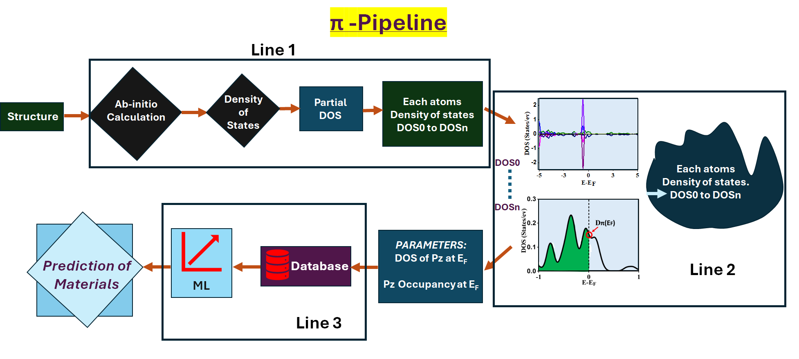
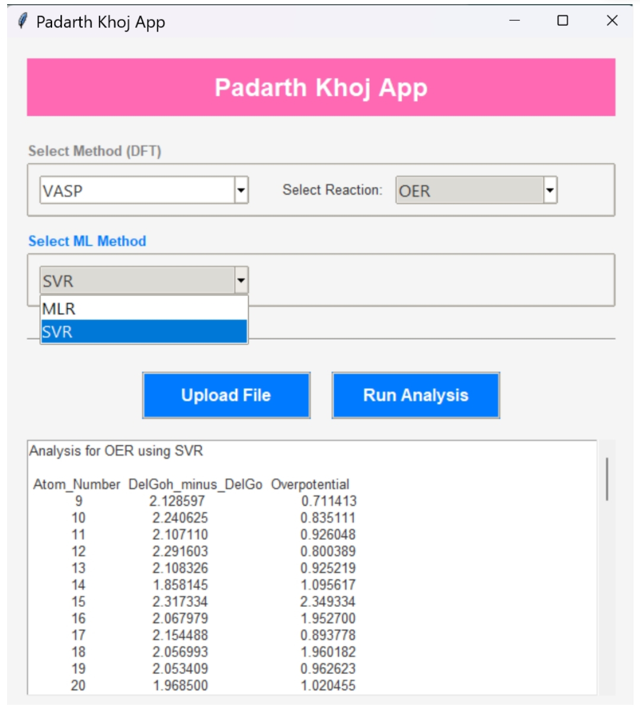
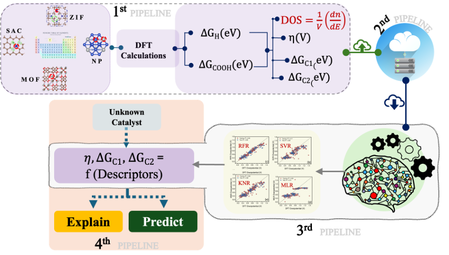
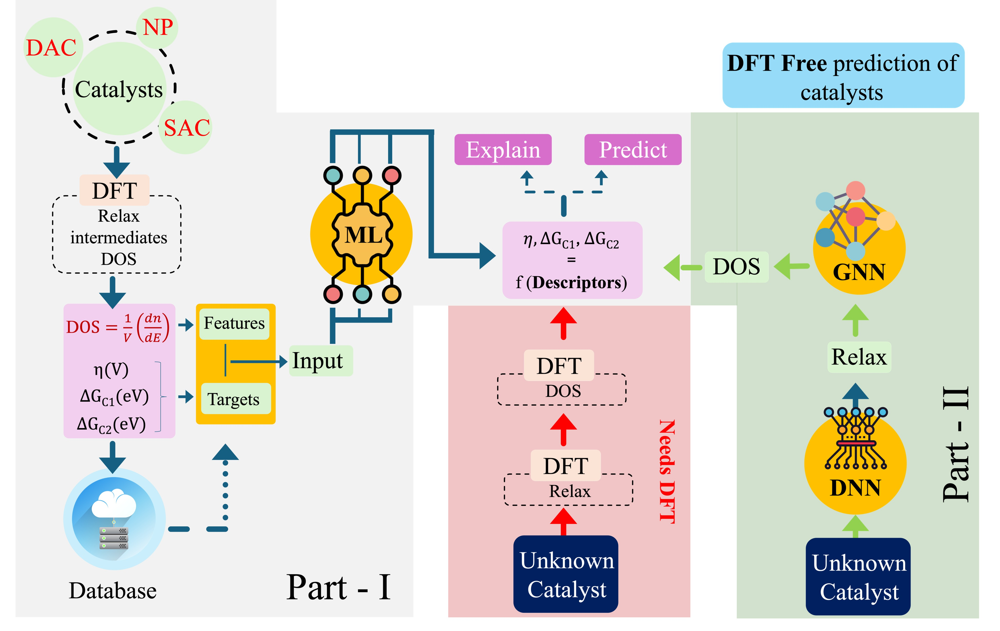
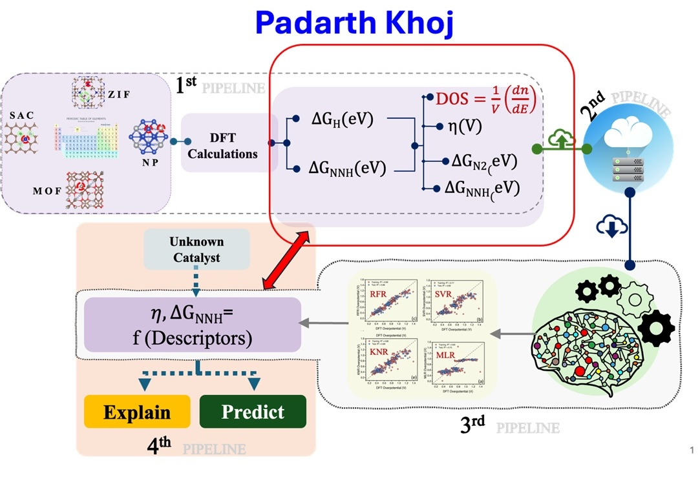

# Padarth Khoj (पदार्थ खोज) - web application of Main Line
- Padarth Khoj: <https://ranjitphy.github.io/padarthkhoj/>
A browser-based toolkit for carbon-based electrocatalysts. Open it in any browser, upload your VASP files, get results.

| Section | What it does |
|---|---|
| **Activity Screening** | `DOSCAR` + `CONTCAR` (+ `OUTCAR`) -> p<sub>z</sub> descriptors -> OER / ORR overpotential per site (SVR / MLR trained on `engine/data/oer.csv`, `orr.csv`), coloured 3D structure, Excel / CSV export |
| **DOS Predictor** | any structure file (CIF, POSCAR / CONTCAR, xyz, cc1, ...) -> predicted PDOS (s, p<sub>y</sub>, p<sub>z</sub>, p<sub>x</sub>, spin up / down) of every atom with the two-stage network in `engine/models`; ZIP of PNG / JPG plots for all atoms |
| **Structure Relaxor** | `POSCAR` + `INCAR` (+ `KPOINTS`) -> relaxed `CONTCAR` with the [MACE](https://github.com/ACEsuit/mace) MACE-MH-1 foundation model through [vasp-mace](https://github.com/rgraucrespo/vasp-mace) |

The interface is the same as the desktop (Electron) app; here a small Python server runs the engine and the browser only uploads files and downloads results.

## Run it on your computer

Needs Python 3.9+ (3.10 - 3.12 recommended). The first start downloads the packages (PyTorch is large).

```bash
git clone https://github.com/ranjitphy/padarthkhoj-web.git      # use this repository's URL
cd padarthkhoj-web
./run.sh                 # Windows: double-click run.bat
```

It creates a virtual environment, installs everything, starts the server and opens <http://127.0.0.1:8000>.
Manual version: `pip install -r requirements.txt && python server/app.py --open`.

## Run it with Docker (also the easiest way to host it)

```bash
docker build -t padarthkhoj .
docker run -p 8000:8000 padarthkhoj          # or: docker compose up --build
```

The image is CPU-only and contains the MACE-MH-1 model, so relaxations work without internet.
GitHub Pages cannot host this app because it needs a Python backend; use any host that runs Docker or Python (a VPS, Render, Fly.io, a Hugging Face Space with the Docker SDK, a lab server, ...).

## Using it

- **Activity Screening**: *Upload DOSCAR* and pick `DOSCAR`, `CONTCAR` and `OUTCAR` together (Ctrl / Shift-click). Choose OER / ORR and SVR / MLR, then *Run analysis*.
- **DOS Predictor**: *Open structure*, *Predict PDOS*, switch atoms with the arrows or by clicking in the structure. *Download plots (ZIP)* renders every atom.
- **Structure Relaxor**: choose `POSCAR`, `INCAR`, `KPOINTS` (or all three at once), edit the INCAR if needed, *Relax structure*. Save the `CONTCAR` or a ZIP of all outputs, or send the result to the DOS Predictor.
  - `KPOINTS` is accepted and kept with the outputs but **not used**: MACE is a force field and has no k-point mesh.
  - Used INCAR tags: `NSW`, `IBRION`, `ISIF`, `EDIFFG`, `PSTRESS`, `IVDW`. MD (`IBRION = 0`), phonons and NEB are rejected.
  - Model and head: MACE-MH-1 (default) is a multi-head model; the **Head** field selects the level of theory (`omat_pbe` default, `oc20_usemppbe` surfaces and adsorbates, `matpes_r2scan`, `omol`, `spice_wB97M`, `mp_pbe_refit_add`). MACE-MP-0 is also available. MACE-MH-1 is released under the ASL (Academic Software License): check its terms before commercial use.
  - Precision: float32 is noticeably faster on CPU; the default is float64 on CPU.
  - The first step is the slowest; importing PyTorch and MACE can take a minute or two the first time. The page shows the current phase and elapsed time.
  - These are surrogate-model results: check important structures with DFT.

## Hosting it for other people

Every browser tab gets its own engine process and scratch folder; files are deleted after the session is idle. Uploads and downloads never expose server paths, and custom `.model` uploads are disabled (they are pickle files that can run code). There is **no login and no rate limiting**: if you expose it to the internet, put it behind HTTPS and a reverse proxy (nginx, Caddy, Cloudflare) and set the limits below to what your machine can carry.

| Environment variable | Default | Meaning |
|---|---|---|
| `PK_HOST`, `PK_PORT` | `127.0.0.1`, `8000` | bind address (`0.0.0.0` to serve other computers) |
| `PK_MAX_SESSIONS` | 6 | engine processes alive at once (each holds the trained models; PyTorch jobs add memory) |
| `PK_MAX_JOBS` | 2 | heavy jobs running at once; others wait |
| `PK_JOB_TIMEOUT` | 1800 | seconds before a heavy job is stopped |
| `PK_IDLE_TTL` | 1800 | idle seconds before a session and its files are removed |
| `PK_MAX_UPLOAD_MB` | 500 | per-file upload limit |
| `PK_MAX_NSW` | 500 | largest `NSW` accepted for relaxations |
| `PK_ALLOW_CUSTOM_MODEL` | 0 | `1` lets users upload their own MACE `.model` (only for trusted users) |
| `PK_DATA_DIR` | `./.padarth-data` | sessions and the downloaded MACE model |
| `PK_PYTHON` | current Python | interpreter used for the engine processes |

`python server/app.py --prefetch-model` downloads the MACE-MH-1 model (57 MB) ahead of time.

## Tests

```bash
pip install playwright && playwright install chromium
python tests/test_protocol.py            # engine
python tests/dos/test_dos_protocol.py    # DOS predictor engine
python tests/relax/test_relax_protocol.py
python tests/web/test_web.py             # real browser: all three sections, uploads, downloads, security checks
```

## Layout

```
server/app.py     FastAPI server: sessions, uploads, downloads, progress stream, limits
web/              the interface (index.html, renderer.js, dos.js, relax.js, viewer.js) + web-shim.js (browser <-> server bridge)
engine/           Python engine (engine.py, dos_predictor.py, relaxor.py, relax_worker.py), trained models, training data
tests/            engine, browser and security tests
```

## Credits and Padarth Khoj Tool

- Founder: PROF. RANJIT THAPA. Main Line Developer: ARUPJYOTI PATHAK.
- Source: <https://github.com/ranjitphy/padarthkhoj>
- Padarth Khoj Tool: <https://coderontheroad.github.io/padarthkhoj-tools/>
- Developer of Padarth Khoj Tool: SOURAV GHOSH

## Citation of the Structure Relaxor components

If you use the Structure Relaxor, please cite:

- Grau-Crespo, R. *vasp-mace: a VASP-style workflow interface for MACE machine-learning interatomic potentials* (2025). Zenodo. <https://doi.org/10.5281/zenodo.19479246> (MIT licence; independent of, and not affiliated with, VASP Software GmbH; it contains no VASP code or POTCAR data).
- Batatia, I.; Kovacs, D. P.; Simm, G. N. C.; Ortner, C.; Csanyi, G. MACE: Higher Order Equivariant Message Passing Neural Networks for Fast and Accurate Force Fields. NeurIPS 2022.
- Batatia, I. et al. Cross Learning between Electronic Structure Theories for Unifying Molecular, Surface, and Inorganic Crystal Foundation Force Fields. arXiv:2510.25380 (2025) (MACE-MH-1; released under the ASL, Academic Software License).
- Batatia, I. et al. A foundation model for atomistic materials chemistry. J. Chem. Phys. 163 (18), 2025 (MACE-MP-0).

## Note
The desktop app can use your own Python environment for the Relaxor; the web version never does (the server runs only its own interpreter).


# padarthkhoj
#### Catalyst Activity Prediction using First-Principles and Graph Neural Networks and Interpretable Machine Learning

## padarthkhoj- OER/ORR


The graphical user interface application for user friendly OER and ORR sp2-Hybridized catalyst materials screening operates through a streamlined sequence of steps. To begin, each material system undergoes two separate DFT computations: one dedicated to relaxing the atomic geometry and another to generate the density of states (DOS). After these simulations, the DOSCAR output is imported into the GUI. Internally, the interface applies the split_doscar to separate and compute the projected density of states (PDOS) for individual atoms. From the PDOS files, two key electronic descriptors are derived. These electronic descriptors calculates the energy descriptors and this energy descriptor serve as input to the predictive model that calculates the overpotential associated with OER and ORR activity in sp²-hybridized systems.

The workflow is built around a reduced-expensive computational strategy: each material undergoes only two DFT steps-structural relaxation and density-of-states (DOS) evaluation. The resulting CONTCAR and DOSCAR outputs are uploaded directly into the GUI. A customised PDOS parser-derived from the Python utility split_dos_11-extracts atom-resolved electronic contributions.

From the PDOS, the interface automatically calculates two key descriptors:

Dπ(EF): the Pz-orbital DOS at the Fermi level

R-Oπ: Relative occupancy, Pz-orbital electrons occupancy shift when graphene is doped or contains defects, compared to pristine graphene.

The GUI includes both SVR and multilinear regression (MLR) models for screening potential electrocatalysts. The extracted descriptors are supplied to the chosen model-SVR-which predicts the adsorption energies of *OH and *O intermediates. These outputs are translated into activity metrics:

ΔGOH for ORR

ΔGO − ΔGOH for OER
followed by the estimation of overpotentials for each site.

The predicted OER/ORR overpotentials show strong correspondence with reference DFT data and are supported by recent experimental reports (Bhardwaj et al., Small 2025, 2411035). This alignment demonstrates the reliability of the tool for accelerating catalyst discovery pipelines.

Users may freely switch between ML models (SVR or MLR). Once DOSCAR and CONTCAR of a sp2-hybridised structure is uploaded, the software reads the site-projected DOS produced by VASP, extracts electronic descriptors, feeds them through in the ML model, and returns downloadable output files listing predicted overpotentials for every atom coordination site-within seconds.


## padarthkhoj- CO2ER_1



## padarthkhoj- CO/CO2ER



## padarthkhoj- NRR

